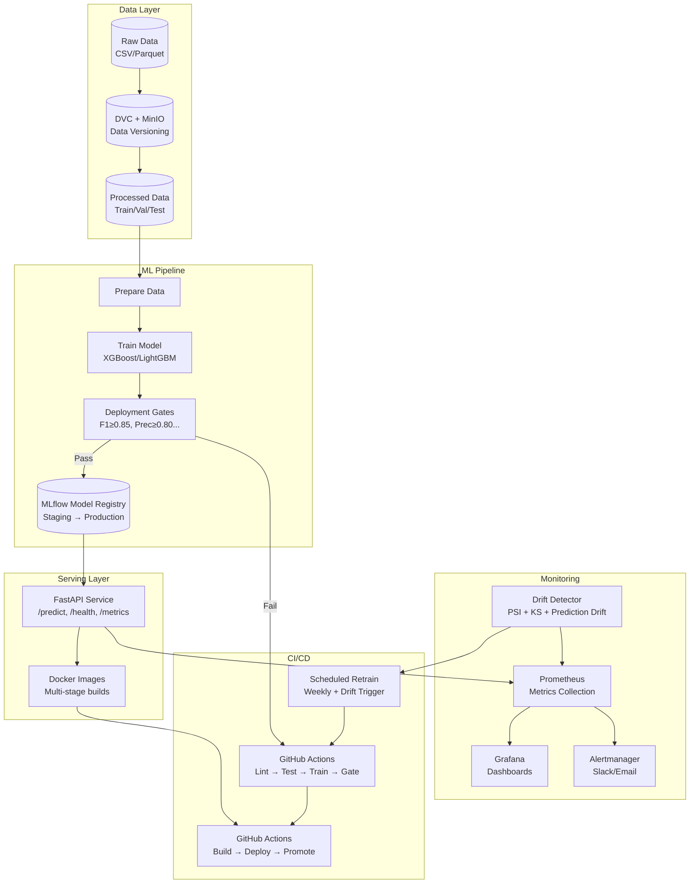

# MLOps Fraud Detection Platform

[](https://github.com/your-org/mlops-fraud-detection/actions/workflows/ci.yml)
[](https://github.com/your-org/mlops-fraud-detection/actions/workflows/cd.yml)
[](https://github.com/your-org/mlops-fraud-detection/actions/workflows/retrain.yml)
[](https://www.python.org/downloads/release/python-3110/)
[](LICENSE)

A production-grade MLOps platform for fraud detection with automated training, deployment, monitoring, and retraining pipelines.

## 🏗️ Architecture



## 🚀 Quick Start

### Prerequisites
- Python 3.11+
- [uv](https://github.com/astral-sh/uv) (fast Python package manager)
- Docker & Docker Compose
- Git

### Local Development

```bash
# Clone and enter project
git clone https://github.com/your-org/mlops-fraud-detection.git
cd mlops-fraud-detection

# Install dependencies
make install

# Install pre-commit hooks
make pre-commit

# Start infrastructure (MinIO, MLflow)
make mlflow-up

# Prepare data (place your data at data/raw/fraud_data.csv first)
make prepare

# Train model
make train

# Start API server
make serve

# Or start full stack
make docker-up
```

### Access Points
| Service | URL | Credentials |
|---------|-----|-------------|
| FastAPI | http://localhost:8000 | - |
| API Docs | http://localhost:8000/docs | - |
| MLflow | http://localhost:5000 | - |
| MinIO Console | http://localhost:9001 | minioadmin / minioadmin |
| Prometheus | http://localhost:9090 | - |
| Grafana | http://localhost:3000 | admin / admin |

## 📁 Project Structure

```
mlops-fraud-detection/
├── .github/workflows/     # CI/CD pipelines
├── data/                  # DVC-tracked data (gitignored)
│   ├── raw/              # Raw input data
│   ├── processed/        # Train/val/test splits
│   └── external/         # Reference data for drift
├── models/               # DVC-tracked model artifacts
├── src/
│   ├── train/            # Training pipeline
│   ├── serve/            # FastAPI inference service
│   ├── monitor/          # Drift detection
│   └── common/           # Shared utilities
├── tests/                # Unit, integration, contract tests
├── docker/               # Dockerfiles & docker-compose
├── mlflow/               # MLflow server config
├── grafana/              # Dashboards & datasources
├── prometheus/           # Prometheus config & alerts
├── reports/              # Generated reports
├── docs/                 # Documentation
├── params.yaml           # All hyperparameters & thresholds
├── dvc.yaml              # DVC pipeline definition
├── pyproject.toml        # Project config & dependencies
├── Makefile              # Common commands
└── .env.example          # Environment template
```

## 🔧 Configuration

All configuration is centralized in **`params.yaml`**:

```yaml
# Key sections:
training:          # Model hyperparameters
preprocessing:    # Data preprocessing options
deployment_gates: # Minimum metric thresholds
serving:          # API configuration
monitoring:       # Drift detection thresholds
mlflow:           # MLflow tracking & registry
dvc:              # DVC remote configuration
```

## 🧪 Testing

```bash
# Run all tests
make test

# Run specific test suites
make test-unit
make test-integration
make test-contract

# With coverage
uv run pytest --cov=src --cov-report=html
```

## 📊 Monitoring

### Grafana Dashboards
- **Model Performance**: F1, Precision, Recall, ROC-AUC, PR-AUC over time
- **API Health**: Latency (p50/p95/p99), error rate, throughput, prediction distribution
- **Data Drift**: Feature PSI/KS scores, prediction drift, model staleness
- **System**: CPU, memory, disk, network, container health

### Prometheus Alerts
- High latency (p99 > 500ms)
- Error rate > 1%
- Prediction drift (> 2σ from baseline)
- Model staleness (> 30 days)
- Infrastructure: CPU, memory, disk

## 🔄 CI/CD Pipeline

### CI (`.github/workflows/ci.yml`)
1. **Lint & Test** - ruff, mypy, pytest
2. **Train** - `dvc repro train` with MLflow logging
3. **Gate** - **Required check** - validates metrics against thresholds
4. **Docker Build** - Multi-arch images to GHCR
5. **Deploy Staging** - Optional staging deployment

### CD (`.github/workflows/cd.yml`)
- Triggered by git tags (`v*`) or manual dispatch
- Smoke tests → Promote to Production → Notify

### Retrain (`.github/workflows/retrain.yml`)
- Weekly scheduled + manual + drift-triggered
- Drift detection → Retrain → Gate → Promote to Staging → Build images

## 🎯 Deployment Gates

| Metric | Minimum Threshold |
|--------|-------------------|
| F1 Score | 0.85 |
| Precision | 0.80 |
| Recall | 0.80 |
| PR-AUC | 0.85 |
| ROC-AUC | 0.90 |

*Adjust in `params.yaml` under `deployment_gates`*

## 📦 Model Serving

### API Endpoints

```bash
# Health check
curl http://localhost:8000/health

# Single prediction
curl -X POST http://localhost:8000/predict \
  -H "Content-Type: application/json" \
  -d '{"amount": 150.0, "merchant_category": "grocery", "tx_type": "online"}'

# Batch prediction
curl -X POST http://localhost:8000/predict/batch \
  -H "Content-Type: application/json" \
  -d '{"transactions": [{"amount": 150.0}, {"amount": 2000.0}]}'

# Model info
curl http://localhost:8000/model/info

# Prometheus metrics
curl http://localhost:8000/metrics
```

### Response Format
```json
{
  "fraud_probability": 0.023,
  "is_fraud": false,
  "threshold_used": 0.5
}
```

## 🔍 Drift Detection

The platform monitors three types of drift:

1. **Data Drift** - Population Stability Index (PSI) & Kolmogorov-Smirnov (KS) on features
2. **Prediction Drift** - Shift in prediction distribution vs baseline
3. **Model Staleness** - Days since last retrain

Run manually:
```bash
make monitor
# or
python -m src.monitor.drift
```

## 🐳 Docker Deployment

```bash
# Build all images
make docker-build

# Start full stack
make docker-up

# View logs
make docker-logs

# Stop all
make docker-down
```

### Production Deployment
```bash
# Tag release
git tag v1.0.0
git push origin v1.0.0

# Or manual dispatch via GitHub Actions UI
# Select environment: production
```

## 🔐 Secrets Management

Configure in GitHub Environments (`staging`, `production`):

| Secret | Description |
|--------|-------------|
| `DVC_BUCKET` | S3/MinIO bucket for DVC |
| `AWS_ACCESS_KEY_ID` | AWS/MinIO access key |
| `AWS_SECRET_ACCESS_KEY` | AWS/MinIO secret key |
| `AWS_DEFAULT_REGION` | AWS region |
| `MLFLOW_TRACKING_URI` | MLflow server URL |
| `MLFLOW_S3_ENDPOINT_URL` | S3 endpoint for MLflow artifacts |
| `GITHUB_TOKEN` | Auto-provided for GHCR |
| `SLACK_WEBHOOK_URL` | Optional: Slack notifications |

## 📚 Documentation

- [Architecture](docs/architecture.md) - Detailed component diagram & data flow
- [Runbooks](docs/runbooks/) - Incident response procedures
- [Contributing](CONTRIBUTING.md) - Development guidelines

### Runbooks
- [High Latency](docs/runbooks/high_latency.md)
- [High Error Rate](docs/runbooks/high_error_rate.md)
- [Prediction Drift](docs/runbooks/prediction_drift.md)
- [Model Stale](docs/runbooks/model_stale.md)
- [API Down](docs/runbooks/api_down.md)

## 🛠️ Tech Stack

| Category | Technology |
|----------|------------|
| ML Framework | XGBoost, LightGBM, scikit-learn |
| Experiment Tracking | MLflow |
| Data Versioning | DVC + MinIO (S3-compatible) |
| Pipeline Orchestration | DVC Pipelines |
| Model Serving | FastAPI + Uvicorn |
| Containerization | Docker + Docker Compose |
| CI/CD | GitHub Actions |
| Metrics | Prometheus + Grafana |
| Package Management | uv |
| Code Quality | ruff, mypy, black, pre-commit |

## 📈 Results

- **F1 Score**: > 0.90 (target ≥ 0.85)
- **API Latency**: p99 < 100ms
- **Deploy Time**: < 5 minutes
- **Retrain Frequency**: Weekly + drift-triggered
- **Test Coverage**: > 80%

## 🤝 Contributing

See [CONTRIBUTING.md](CONTRIBUTING.md) for:
- Development setup
- Commit conventions
- PR process
- Code style guide

## 📄 License

MIT License - see [LICENSE](LICENSE) for details.

---

**Built with ❤️ for production ML**