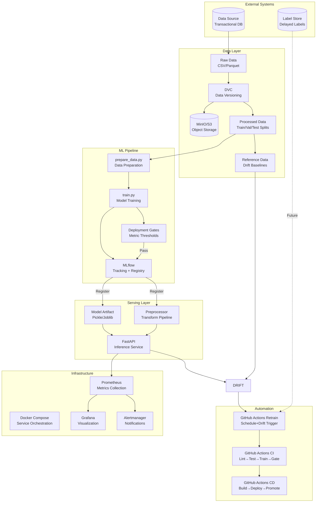

# Architecture Documentation

## System Overview

The MLOps Fraud Detection Platform is a comprehensive, production-ready machine learning operations system that automates the entire lifecycle of a fraud detection model—from data ingestion and model training to deployment, monitoring, and automated retraining.

## Component Architecture



## Data Flow

### 1. Data Ingestion & Versioning
```
Raw Data (CSV) → DVC Track → MinIO/S3 Remote
                    ↓
            dvc.yaml (prepare stage)
                    ↓
        Train/Val/Test Splits (Parquet)
        Preprocessor (Pickle)
```

**Key Points:**
- Raw data stored in `data/raw/` (DVC-tracked, gitignored)
- Processed splits in `data/processed/` (DVC-tracked)
- Preprocessor saved for consistent inference transforms
- DVC remote: MinIO (dev) → S3/GCS/Azure (prod)

### 2. Training Pipeline
```
Processed Data → train.py → Model + Metrics
                      ↓
              MLflow Logging
                      ↓
              Deployment Gates Check
                      ↓
              Model Registry (Staging)
```

**Training Steps:**
1. Load processed train/val data
2. Create model from `params.yaml` config
3. Train with early stopping
4. Evaluate on validation set (5 metrics)
5. Log params, metrics, artifacts to MLflow
6. Save model + metrics for DVC
7. Check deployment gates

### 3. Model Registry & Promotion
```
MLflow Model Registry
├── Staging (auto-promoted on gate pass)
├── Production (manual/CD promotion)
└── Archived (old versions)
```

**Stage Transitions:**
- CI gate pass → Auto-promote to `Staging`
- CD workflow / Manual → Promote to `Production`
- New Production → Archive previous

### 4. Inference Serving
```
API Request → Pydantic Validation → Preprocessor → Model → Response
                 ↓                              ↓
            Prometheus Metrics            Structured Logging
```

**Endpoints:**
- `GET /health` - Liveness/readiness
- `POST /predict` - Single prediction
- `POST /predict/batch` - Batch predictions
- `GET /model/info` - Model metadata
- `GET /metrics` - Prometheus metrics

### 5. Monitoring & Observability

**Prometheus Scraping:**
```
api:8000/metrics → Prometheus → Grafana Dashboards
mlflow:5000     → Prometheus → Model metrics
node-exporter   → Prometheus → System metrics
```

**Key Metrics:**
- Request latency (histogram: p50, p95, p99)
- Request rate & error rate
- Prediction distribution (fraud vs non-fraud)
- Fraud probability distribution
- Custom: drift scores, model age

**Alert Rules:**
| Alert | Condition | Severity |
|-------|-----------|----------|
| High Latency | p99 > 500ms for 5m | Warning |
| High Error Rate | 5xx rate > 1% for 2m | Critical |
| Prediction Drift | > 2σ from baseline for 10m | Warning |
| Model Stale | No retrain in 30 days | Warning |
| API Down | up == 0 for 1m | Critical |

### 6. Drift Detection

**Data Drift (Weekly/Scheduled):**
- PSI (Population Stability Index) per feature
- KS (Kolmogorov-Smirnov) statistic per feature
- Thresholds: PSI > 0.2, KS > 0.05

**Prediction Drift (Real-time):**
- Compare current fraud rate vs baseline
- Alert if > 2 standard deviations

**Model Staleness:**
- Track model file modification time
- Alert if > 30 days

### 7. Automated Retraining

**Triggers:**
1. **Scheduled** - Weekly (Monday 2 AM UTC)
2. **Drift Detected** - Any drift check fails
3. **Manual** - Workflow dispatch
4. **Performance Drop** - Future: label feedback

**Retrain Flow:**
```
Drift Check → Retrain (dvc repro) → Gate Check → Promote to Staging
                                                              ↓
                                                    Build Docker Images
                                                              ↓
                                                    Push DVC Updates
                                                              ↓
                                                    Notify Team
```

## Deployment Topology

### Development (Local Docker Compose)
```
┌─────────────────────────────────────────┐
│           Docker Host                   │
│  ┌─────┐ ┌──────┐ ┌─────┐ ┌──────────┐ │
│  │MinIO│ │MLflow│ │ API │ │Prometheus│ │
│  └─────┘ └──────┘ └─────┘ └──────────┘ │
│  ┌────────┐ ┌────────┐ ┌────────────┐  │
│  │ Grafana│ │Node Exp│ │Dr Detector │  │
│  └────────┘ └────────┘ └────────────┘  │
└─────────────────────────────────────────┘
```

### Production (Recommended)
```
┌─────────────────┐     ┌─────────────────┐
│   Load Balancer │────▶│  API Replicas   │
│   (nginx/ALB)   │     │  (K8s/ECS/Farg) │
└─────────────────┘     └─────────────────┘
                              │
        ┌─────────────────────┼─────────────────────┐
        ▼                     ▼                     ▼
┌───────────────┐    ┌───────────────┐    ┌───────────────┐
│  MLflow       │    │  Prometheus   │    │  MinIO/S3     │
│  (Managed/RDS)│    │  (Managed)    │    │  (Managed)    │
└───────────────┘    └───────────────┘    └───────────────┘
```

## Configuration Management

### params.yaml (Single Source of Truth)
```yaml
# All configurable parameters:
training:          # Model hyperparameters
preprocessing:     # Data transforms
deployment_gates:  # CI gate thresholds
serving:           # API config
monitoring:        # Drift thresholds
mlflow:            # Tracking config
dvc:               # Remote config
```

### Environment Variables (.env)
```bash
# Runtime secrets (not in git)
MLFLOW_TRACKING_URI=
MINIO_ACCESS_KEY=
MINIO_SECRET_KEY=
AWS_*_KEY=          # For production S3
SLACK_WEBHOOK_URL=  # Optional alerts
```

## Security Considerations

1. **Non-root containers** - All Dockerfiles use `appuser`
2. **Secrets in GitHub Environments** - Not in repo
3. **Network isolation** - Docker Compose network
4. **Read-only mounts** - Data/model directories
5. **Health checks** - All services have liveness probes
6. **Resource limits** - Memory/CPU constraints in compose

## Scalability Path

| Component | Current | Scale Path |
|-----------|---------|------------|
| API | Single container | K8s Deployment + HPA |
| MLflow | SQLite + Local FS | PostgreSQL + S3 |
| MinIO | Single node | MinIO Cluster / S3 |
| Prometheus | Single node | Thanos / Cortex |
| Grafana | Single node | Grafana Cloud / HA |
| DVC | Local remote | S3/GCS/Azure Blob |
| Training | On-demand container | K8s Jobs / Vertex AI / SageMaker |

## Failure Modes & Mitigations

| Failure | Detection | Mitigation |
|---------|-----------|------------|
| API Down | Prometheus `up` metric | Health checks, restart policy |
| High Latency | p99 alert | Auto-scale, caching |
| Model Degraded | Drift alerts | Auto-retrain, rollback |
| Data Pipeline Fail | CI failure | DVC repro, manual rerun |
| MLflow Unavailable | Prometheus alert | Local model fallback |
| MinIO Unavailable | Health check | Multi-AZ, backup |

## Future Enhancements

1. **Feature Store** - Feast/Vertex AI Feature Store
2. **Label Feedback Loop** - Async label matching
3. **A/B Testing** - Canary deployments
4. **Model Explainability** - SHAP integration
5. **Data Contracts** - Schema registry
6. **Multi-model Serving** - Ensemble/routing
7. **Kubernetes** - Full K8s deployment
8. **GitOps** - ArgoCD/Flux for deployments